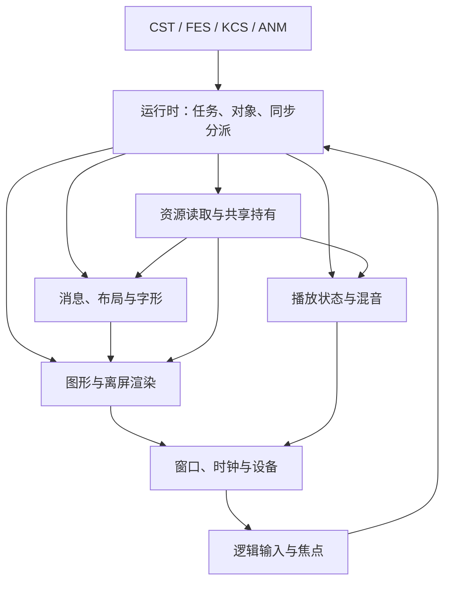

# 运行时与媒体子系统设计

适用基线为 Windows CatSystem2 **2.6.1.90**。本页描述拟采用的模块职责、数据流和对接约定；原引擎行为以各脚本契约及原入口记录为准。实施阶段、优先级与验收任务统一维护在 [GOAL.md](../GOAL.md)。

## 模块边界

|模块|负责|向解释器提供|
|:--|:--|:--|
|运行时 `runtime`|对象工厂、对象存储、任务树、配置、逻辑更新和同步分派|TaskServices、SceneSource、对象／命名值和任务返回状态|
|资源 `resource`|类别补全、归档／散装读取、资源身份和共享持有|ResourceServices 及原始字节；读取失败与宿主故障分别报告|
|图形 `graphics`|图像解码、帧选择、二维对象、渲染面、绘制与读回|图形对象创建／释放、属性查询、绘制操作及完成状态|
|文字 `text`|编码上下文、消息标记、布局、字形、显示进度与命中区域|姓名／正文／选项显示请求及输入等待状态|
|音频 `audio`|解码、播放实例、循环／标签、增益／淡变、混音与设备提交|播放、停止、位置、完成／标签查询和资源生命周期|
|输入 `input`|指针坐标变换、按键／按钮状态、焦点及对象事件|逻辑输入状态与 FES 事件；平台坐标只在边界转换|
|平台 `platform`|窗口、操作系统时钟、输入采集、图像呈现、音频设备及系统请求|平台能力与事件，不解释脚本语法|

初次接入按实际对象类型显式分派，复用现有 Control、OrdinaryTask、ImageState、MotionQueue 和 ImageAnimation。具体类型增多后再评估重复代码，不预先建设通用插件注册或反射框架。

## 所有权与操作状态

运行时持有对象及其任务身份，脚本通过已核实的编号／句柄访问。原始文件、已解码图像、渲染目标和播放实例分别管理类型，跨域调用必须检查类型。当前解码图像、原始数据、XML、序列集合和整数字典已共用 `HandleAllocator`；后续脚本可见的不透明资源句柄继续使用同一编号源。零保留为空，释放及任务编号复用均不复用资源句柄。任务编号与 VM 地址保留各自的命名空间。

图像或声音仍持有资源时，释放装载者只解除该持有者的引用；最后一个使用者结束后回收数据。365 创建的原始图像数据与 111／115／117 使用的已解码图形对象分别保存。现有 ResourceHost 的直接释放路径在接入共享解码对象时需要相应调整。

运行时已整合 365／366／368 和 590～593，与 111 共用同步资源服务。原始数据和 XML 供任务间传递，显式关闭或运行时销毁才结束生命周期，替换读取服务不影响已装载对象。解码图像仍按所属任务释放；缓存及额外共享使用者尚未接入。

加载、运动、转场、逐字显示和播放分别维护完成状态及对应操作身份。停止、替换、失败和自然结束保留各自结果；脚本等待怎样消费这些结果，需要按该等待入口的契约决定。资源替换采用递增请求版本，旧请求返回时检查所属实例和版本，避免覆盖新内容。

现有同步 native 在返回前完成其规定的读写和状态提交。预取或后台解码可以提前准备数据，但不得把尚未完成的同步读取当作缺失资源返回零。Retry、消息等待和宿主事件确认继续使用各自已核实的恢复协议。

## 更新与呈现

平台毫秒、任务整数时刻、逻辑帧和音频采样帧分别表示。现有 TaskClock、Timeline 和 MotionQueue 保留各自的换算顺序、回绕及哨兵规则；根时钟如何换算为这些输入仍需沿完整更新链确认。刷新次数不作为脚本计时来源，画布尺寸和目标刷新率从配置取得。

任务更新复用现有树调度：先当前时钟，再直属子任务，最后当前对象主体及对应清理。对象主体在自己的规定时点推进运动、ANM、文字或播放状态；外层不再对同一对象额外推进一次。预算续跑完成同一次更新，保留原输入时间。

绘制使用已提交的对象状态。CST 的 draw／rdraw、消息、输入及 wait 的提交边界分别实现；修改对象不自动等同于立即呈现。设备呈现可以独立刷新最近完成的画面。平台输入和音频状态的采样时点作为运行时对照项固定下来。

## 图形

图像读取沿现有类别配置和 ResourceRouter 查找，HG-3 元数据继续复用 `hg3::Metadata`。像素解码先覆盖基线已经出现的 0x300、原生 img 编码和 32 位像素，再按真实可达需求补其他格式。

解码结果保存像素、尺寸和行跨度，同时保留帧 ID、裁剪偏移、完整画布和绘制基点。相同 ID 选文件中首个匹配帧；帧 ID、数组位置、最大 ID 和保留帧 10000 各自解释。选帧完成后向 ANM 提供最大 ID、保留帧是否存在及实际选帧结果。

先提供可离线调用的像素解码和二维合成函数，输出普通像素缓冲区。原输出通道顺序、行方向、Alpha 表示和舍入规则核实后，确定统一内存像素格式；原文件布局到内部布局的换算集中在解码边界。

基础绘制覆盖纯色矩形、图像区域、裁剪、平移、优先级、显隐和已核实混合方式。后续缩放、旋转、遮罩、转场和粒子绘制沿实际对象入口补齐。相同优先级的顺序、父子坐标与裁剪传播、Base／Offset 的组合及 Alpha 舍入都需要独立确定，不能用窗口尺寸修正资源坐标。

需要像素读回的操作使用可查询的渲染面。117 已接入两条路径：非零图像按底端起始坐标覆盖原始 ARGB；零句柄按顶端起始坐标清零当前 CPU 绘图目标、忽略颜色，并按上下文开关及面块存在性登记更新。绘图上下文由调度宿主设置，窗口呈现尚未接入。111 的组合资源和任务持有已实现，对象缓存及额外共享持有继续核实。

115 已接入图像间普通混合与当前目标 BGRA 复制，两条路径的源矩形坐标和行方向各自保留；均叠加源偏移且不按请求目标尺寸缩放。同图混合保持即时重叠反馈，当前目标复制按块登记更新。`Transform` 已提供基点、缩放、旋转、显式矩阵、平移及父级坐标组合，保留原四维 W 及数值规则。`Projection` 保留设备前的平面／透视分支、坐标组与最终矩阵及 RHW，`Drawable::projected_triangle` 已组合对象变换与投影。`Drawables` 提供三角形登记、颜色覆盖和按基点 Z 的稳定归并，`PlaneObject`／`GraphicsFactory` 已接基础二维任务生命周期、矩形／空图元、向量／矩阵属性与查询和内部子级传播，普通 78／79／80／82／83／84／100／101 通过显式缓冲区接入。基础纯色三角形现由 CPU 栅格化至分块目标，运行时在 update 后显式调用 `render_triangles`，保留排序、显示及上下文门控。RHW 顶点颜色插值与纹理 CPU 核心已接入，过滤由调用者显式选择；设备精度差异详见验证记录。显式画布图元、矩形纹理包装及独立帧输出已接入；特殊混合、对象上下文切换、图像缩放及完整画面／设备提交继续实现。

完整帧将画布面块作为只读纹理输入，将最终帧作为独立输出。命令 41 使用这类画布纹理矩形，命令 42 使用非纹理纯色矩形；纹理包装按源变换切割并生成局部 UV，再单独应用包装变换和半像素偏移。后续整合保留这一边界，避免在绘制期间对同一份画布同时取样和覆盖。`render_frame` 已将显式画布图元、矩形纹理包装和独立输出串联，`render_triangles` 保留非纹理基础提交。源属性更新在可见帧提交前重新切割；主循环自动更新／提交及设备呈现继续实现。

112 已接入不依赖资源服务的空白图像创建，114 可提前释放图像并解除任务持有；后续任务回收处理剩余对象。零尺寸图像保留非零句柄和完整几何，画布尺寸保持零。

平台呈现先接最小桌面窗口。GPU 后端在像素和提交规则明确后接入，继续使用相同的图像、坐标和合成约定。离屏缓冲区同时作为自动验证及设备缺失时的开发入口。

## 文字与消息

保留输入来源和编码信息：基础 CST 使用 CP932，CSTL 使用 UTF-8，FES 的字符串对象按类型和配置解释。不得在容器读取时统一将整个 FES 解码为一种文本。CSTL 的 U+001F 片段绑定在进入布局前完成，缺失语言与明确空值分别保留。

消息层维护姓名、正文页、追加位置、当前样式、逐字进度、等待及选项。连续 Message、换行、续写和翻页具有不同操作；语言切换、空姓名及正文回退先遵循已确认路径，其余明确列为待核实。

`Markup::schedule` 已提供普通／句末间隔、空格跳过、w／wf／wr 换算和注音显示关联，输出逐布局记录的原始显示时间及后续片段计数。`message::Page` 已接入延后解析的追加、整页准备和清空，保留样式、分组编号、旧换行及时间，重新绑定注音时更新对应时间。普通逐字显示提供逐条可见性、速度切换、分隔范围、完成状态和剩余字形数量；字形效果和渐显核心见下文；消息对象和宿主等待继续接入。

水平渐显核心已提供 `message::Reveal`、`RevealGlyph` 和 `Layout::reveal_starts`，使用独立的原始时间换算、跨行距离及持久 Alpha 更新。`message::Display` 已串联普通／渐显页面推进、预生成、分隔范围、状态与完成查询、追加、重排和清空，来源同步 RGB 时保留目标 Alpha。字形服务失败后可重试，已有字形不重复混合；脏区按实际绘制及渐显登记累计，由调用者显式清除，清空文字保留已有登记。显示重配置从新默认样式重解析完整来源，重建像素并重置字形与时间，保留速度；准备失败可保留原对象重试。类型 48／63 的消息任务已通过专用工厂、字体服务和配置命令接入普通／渐显及画布提交，共用平面图元与最终帧路径；每轮先绘制旧播放时间，再累加输入时刻差。完成快照只在普通非空脏区提交后刷新，可见页启动独立地复制整页。普通 KCS 文字 native、CST 姓名／正文、输入翻页与脚本完成等待继续接入。

标记解析产生文本、换行、不可分词组、注音、颜色／字体变化、对齐和显示等待等片段，保持源位置和未识别标记诊断。正文颜色 AABBGGRR 与对象 ARGB 在边界明确换算。字体／颜色恢复范围、注音尺寸、禁则与逐字计数单位分别核实。

布局接受确定的字形度量、文本片段及消息区域，输出字形位置、注音位置、行范围与可命中区域。换行、禁则、分组、悬挂缩进、Unicode 单词换行、对齐和注音定位已通过 `message::Markup::layout` 接入，保留 CP932／Unicode 两条对象路径及其默认字符集合，契约见 [消息标记与布局](message.md)。`message::Font` 已提供显式字体的度量与栅格化，`GlyphMask` 保留六十四级覆盖，`Page::paint_foreground` 将已显示的正文／注音连接到 BGRA 像素。`GlyphEffects` 与 `Page::paint` 已接入轮廓、偏移阴影及前景合成，保留彩色阴影的独立字节顺序；GDI 字体适配、选项布局和消息对象继续接入。字形缓存键包含字体身份、字形、尺寸和实际影响像素的样式。

字体回退次序、缺字处理和字体资源授权明确后再提供默认字体。默认 CI 的布局测试使用合成度量；栅格化回归使用项目生成的固定几何字体，缺字明确诊断。fontdue 和 ttf-parser 均选择 MIT 许可，声明随项目保存。文字层输出图形可绘制的字形图像，不自行创建窗口或查询系统时间。

逐字显示按消息对象时钟推进，快进、一次显示全部、等待点击、自动播放和语音结束分别作为消息操作。历史记录保存结构化姓名／正文、语言和必要样式，排版结果可按当前显示设置重建。

## 音频

先识别基线实际使用的编码和容器，区分解码器、播放实例、混音器与设备输出。解码器输出明确采样率、声道布局和采样帧数的 PCM；首个离线混音接口采用固定采样格式，并将重采样和声道转换放在明确的边界。

资源身份与播放身份分开。同一音频可以被多个实例使用；背景音乐、语音及音效是否采用独占或多实例，由对应脚本／对象契约决定。播放状态包括当前位置、循环、增益、淡变及停止／替换原因。实例替换使旧加载或设备回调失效。

循环点和标签在 API 中带单位，尚未核实的原始 i64 保留原值。普通 400 及声音命令 199 的单位、端点包含关系、−1 含义、标签定位和 seek 行为需要对照后确定，不能在读入时默认当作毫秒或直接除以采样率。

`audio::LoopPoints` 已保存 199 的原始循环范围，按名称忽略 ASCII 大小写查找；重复登记只更新起点，保留首次终点。有效性检查使用本次传入范围，终点 -1 跳过大小比较。它目前独立于声音任务与设备，完整契约见[声音接口](audio.md)。

设备实际消费的采样帧作为播放位置来源，脚本时钟负责已核实的控制和淡变。设备回调只消费准备好的数据，避免在回调中读取归档、执行脚本或取得运行时的大范围锁。设备欠载、暂停和结束通知明确交给播放状态层处理。

无参 wait、wait pcm／se／tag 的条件分别由宿主解释；循环声音不自动成为永不完成的全局等待。音频加载失败、停止、替换及标签缺失时，按相应入口处理备用等待或错误。

## 输入、窗口与系统能力

输入层保留物理设备位置，`CoordinateMap` 已提供设备缩放／偏移、配置整数偏移与逻辑缩放的两级双向转换。`Runtime::set_input_device` 绑定可同步查询的 InputDevice，输入主体按原顺序组合定位、选择、按键、滚轮、拖动、自动光标与收尾；回调后再次查询时能观察设备变化。138／139 已连接前台门控、定位前键清理和逐轮设备移动，138 的配置开关由宿主设置。普通 native 149 即时查询并更新 `CoreHost.pointer_position`，无设备时使用缓存。负值和画布外位置继续保留，命中测试单独决定可交互区域；配置绑定和平台采集继续实现。

按下、保持、释放、滚轮和焦点变化分别缓存。FES 导航复用 KEYBLOCK 邻接，结合可见性、启用状态、银行和实际命中区域生成对象事件。命令 96／97 和输入命令 137 的状态更新尚未完整核实，先不将其等同于通用按钮状态。

窗口负责尺寸变化、呈现、平台时间和已授权的系统操作；菜单请求和 SystemServices 继续在平台边界执行。用户界面不显示内部 native 编号、句柄或验证状态。

## 解释器对接点

|现有入口|子系统侧责任|解释器侧责任|
|:--|:--|:--|
|CST SceneSource／事件|读取场景，执行显示／播放／消息／输入操作并返回完成状态|保留记录、预处理、场景调用、选择和事件确认位置|
|FES 创建／初始化／命令事件|对象、银行、父子关系、资源、属性及对象操作|声明／参数／宏求值、事件分派和子命令绑定|
|TaskHost／TaskServices|真实工厂、目标对象、同步路由及 VM 所有权|已核实 native 包装、数据顺序和预算恢复|
|ResourceHost／ResourceServices|类别与资源读取、共享生命周期|名称格式展开、XML／原始数据与元数据调用|
|ImageState／MotionQueue／ImageAnimation|在对象更新时应用属性、选择帧并提交画面|已核实的属性求值、运动与时间线执行|
|普通 111／112／114／115／117／400|提供已核实的图形／声音对象操作|解析参数、按原状态返回并保留失败／等待语义|

具体 Rust 签名随首个调用链落地，继续沿现有显式服务风格扩展。设计约定不替代尚未完成的基线接口核实。

## 验证与后续扩展

像素解码、裁剪／混合、文字布局、PCM 混音和状态转换使用小型合成输入测试。外部资源对照显式运行，比较完整像素、状态、操作顺序和必要的采样位置；图形设备、音频设备、系统字体和游戏数据均不进入默认测试依赖。

原生存档后续保存逻辑对象、资源身份、时钟、已提交画面、文字进度和声音位置，再重建设备资源。CSS 字段布局与恢复时序核实后实现；当前不把自定义序列化格式当作原生兼容。

E-mote、原生粒子 DLL、其他图像编码和跨版本差异在产生实际可达需求时分别评估。新图形、字体、音频依赖及用于验证的资源在引入前核对许可证和分发义务。
